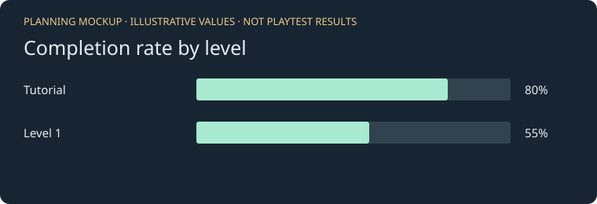
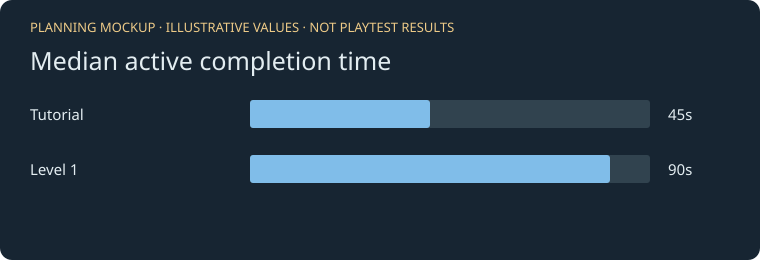
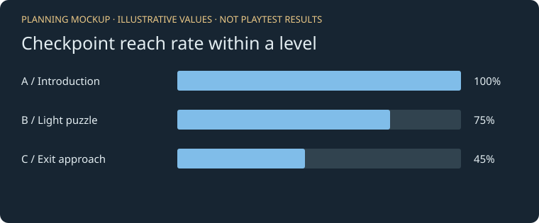
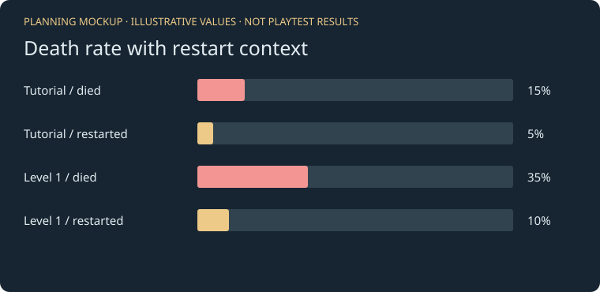

# Analytics for Alpha

Draft for the shared GDD. The images show graph layouts, not playtest results. The hypotheses below still need real playtest data. Compare the same build and show sample counts.

## 1. Level completion rate

**Measure:** completed attempts divided by all started attempts, per level. Restarting starts another attempt. Unfinished runs stay in the denominator.

**Why:** shows which levels players can finish and where teaching or difficulty needs review.

**Read it:** a low rate flags a level to watch. Check deaths, progress, and player feedback to find the cause. Attempts are not unique players.

**Hypothesis:** after 20 started attempts on the same build, tutorial completion will be at least 70%.

**Graph:** one bar per level, with completed/started counts and percentage.

## 2. Active completion time

**Measure:** median active seconds for completed attempts, per level. Exclude pauses, loading, menus, and time without game focus. Show no value if nobody finishes.

**Why:** helps check how long successful runs take. The median limits the effect of unusually long runs.

**Read it:** long times can mean a good puzzle or unclear instructions. Short times can mean mastery or a shortcut. Check completion rate and playtest notes too; failed runs are excluded here.

**Hypothesis:** after 10 completions per level on the same build, Level 1's median time will exceed the tutorial's.

**Graph:** seconds per level, with the number of completed attempts.

## 3. Checkpoint reach rate

**Measure:** attempts reaching each progress marker divided by starts in that level. Count each marker once per attempt, using player body contact. These markers do not change respawn.

**Why:** helps find the section where players stop making progress.

**Read it:** compare markers in route order. Check alternate paths and backtracking before treating a drop as a difficulty problem. Only observed markers appear; a missing marker is not a measured zero.

**Hypothesis:** after 20 starts in a marked level, the marker after its first light puzzle will have a reach rate at least 10 percentage points below the marker before it.

**Graph:** percentage bars in route order, with arrival counts. The example names are planned marker positions.

## 4. Death rate by level

**Measure:** attempts ending in Game Over divided by all starts. Show manual restart rate separately. Quits, leaving, and unfinished runs are not deaths.

**Why:** separates failed runs from players choosing to reset a puzzle.

**Read it:** high deaths can mean challenge or unclear hazards. High restarts can mean practice or a setup that feels stuck. The data does not identify the hazard responsible.

**Hypothesis:** after 20 starts per level on the same build, Level 1's death rate will exceed the tutorial's by at least 10 percentage points.

**Graph:** paired death/restart percentage bars with counts.

## Method

The game records starts, outcomes, timing, and first marker arrivals through its Core service and menu events. Each event has random session, attempt, and event IDs, a sequence number, level/build, platform, UTC time, and the measured values. It collects no names, emails, or device IDs.

WebGL saves recorded events in browser local storage. After a playtest, the player downloads a JSON file using the button below the game. The team imports one or more files into the bundled graph viewer. Files are processed on that computer, without a network upload or hosted database. Downloads keep the saved events; repeated files and overlapping downloads are deduplicated by event ID. Conflicting or malformed imports leave earlier results unchanged. Storage restrictions can leave events in memory only, so players should download before closing the page. Browser shutdown can leave a run unfinished.

The viewer calculates the four metrics directly from the imported game events and provides build/level filters, sample counts, event details, and CSV exports. No mock observations are inserted into these graphs. The team must collect the downloaded files from testers through its agreed channel; this transfer is manual. Save original files and distinguish QA runs from peer data.

Timing and outcomes work in the gameplay scenes without new scene objects. New markers currently exist only in AnalyticsLab; the team still needs to choose positions in its levels for metric 3.

## Before adding this to the GDD

After review and publication, add the Alpha playable URL, bundled graph-viewer link, source commit link, and a screenshot of real WebGL exports imported into the graphs. Document the manual download/import steps and browser validation results. Local test runs are QA evidence, not peer playtest findings. See [the setup guide](WEBGL_ANALYTICS_GUIDE.md).
