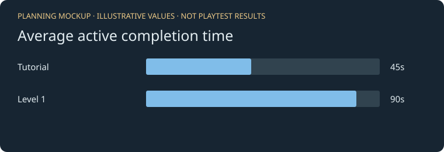
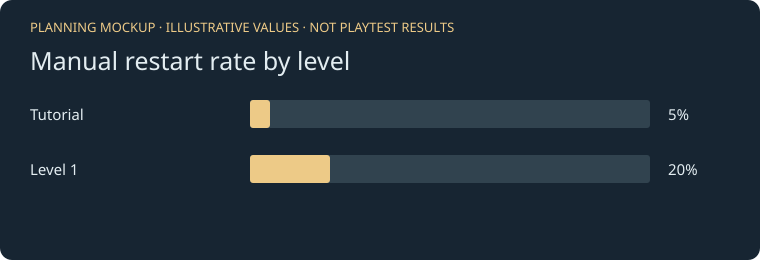
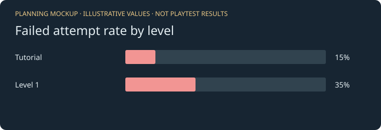

# Analytics for Alpha

Draft for the shared GDD. These four plans use the team's Firebase / Google Analytics approach. Mockup values are examples, not playtest findings. Compare the same build and show the number of attempts.

## 1. Level completion rate

**Measure:** `level_completed` count / `level_started` count x 100, per level. A retry starts a new attempt. Unfinished runs stay in the denominator. Attempts are not unique players.

**Why:** helps us find levels players cannot finish.

**Read it:** a low rate flags a level to watch. Check failures, restarts, and player feedback before deciding what caused it.

**Hypothesis:** after 20 starts on the same build, tutorial completion will be at least 70%.

**Graph:** bars by level, with completed/started counts and percentages.

## 2. Active completion time (new)

**Measure:** average `active_seconds` on `level_completed`, per level. Sum those seconds and divide by completed attempts. Exclude pauses, loading, menus, and background time. Failed attempts have no completion time. Show no value if there are no completions.

**Why:** helps us check whether successful runs take longer than expected.

**Read it:** a long time could mean an engaging puzzle or unclear instructions. Check player feedback. Averages can be affected by unusually long runs; this is not a median.

**Hypothesis:** after 10 completions per level on the same build, Level 1's average active time will exceed the tutorial's.

**Graph:** average seconds per level with completion counts.

## 3. Manual restart rate (new)

**Measure:** `level_restarted` count / `level_started` count x 100, per level. Count only a restart chosen while the run is unfinished, including from pause. A retry after death or victory is a new start, not a manual abandon. Leaving for the menu is not a restart.

**Why:** helps find puzzles where players reset their setup or feel stuck.

**Read it:** compare restart rates with failures and feedback. A reset can also be practice; it does not prove a design problem.

**Hypothesis:** after 20 starts per level on the same build, Level 1's restart rate will be at least 10 percentage points higher than the tutorial's.

**Graph:** restart percentages by level, with restart/start counts.

## 4. Failed attempt rate

**Measure:** `level_failed` count / `level_started` count x 100, per level. This is Game Over, not every checkpoint respawn or every falling death. Repeated outcome callbacks count once. Restarts and leaving are not failed attempts.

**Why:** separates failed runs from players choosing to reset a puzzle.

**Read it:** a high rate can mean challenge or unclear hazards. This metric does not identify which hazard caused the failure.

**Hypothesis:** after 20 starts per level on the same build, Level 1's failed-attempt rate will exceed the tutorial's by at least 10 percentage points.

**Graph:** failed-attempt percentages by level, with failure/start counts.

The team's coin collection and falling-death metrics are separate additions. They should use the same level/build filters once those events are implemented.

## Method

The Unity menu controller records one start per gameplay scene load. It updates a clock only while the game is playing and focused. On victory it sends `level_completed` with numeric `active_seconds`; on Game Over it sends `level_failed`. A restart during an unfinished run sends `level_restarted`, and the reloaded scene starts a fresh clock. Every event includes `level` and `build_version`. Completion time covers the successful attempt since its scene load, not time spent on earlier failed attempts. A checkpoint respawn within the same scene keeps the clock; reloading starts a new clock even if the player spawns at a saved checkpoint.

Events go through the existing `WebAnalytics.Track(...)` helper and the team's Google tag to Analytics. The game uses the teammate's existing collection setup. There is no local collector or manual JSON upload in the normal build. The earlier download/import version remains in source history as a backup.

The property owner must register the custom level/build dimensions and active-seconds metric, then make the graphs in Analytics. Completion, failure, and restart rates need matching event counts for the same level/build. Do not mix old events without the new parameters into those rates. Collection can be blocked by browser settings or extensions, so these rates describe received events, not every player who visited.

Local tests check timing, pause/background exclusion, restart handling, duplicate outcomes, and WebGL bridge payloads. A development-only capture page shows real game calls without sending test events to Google. It is QA evidence, not proof of server receipt or peer-playtest results. Live dashboard verification is pending property access and publication of the rebuilt game.

## Before submission

Add the published playable link, source commit, and screenshots from the actual Analytics property. The property owner still needs to confirm that the new parameters arrive and the graphs display them. Replace this draft's test status with the final build and playtest results after that check. See [the short guide](WEBGL_ANALYTICS_GUIDE.md).
